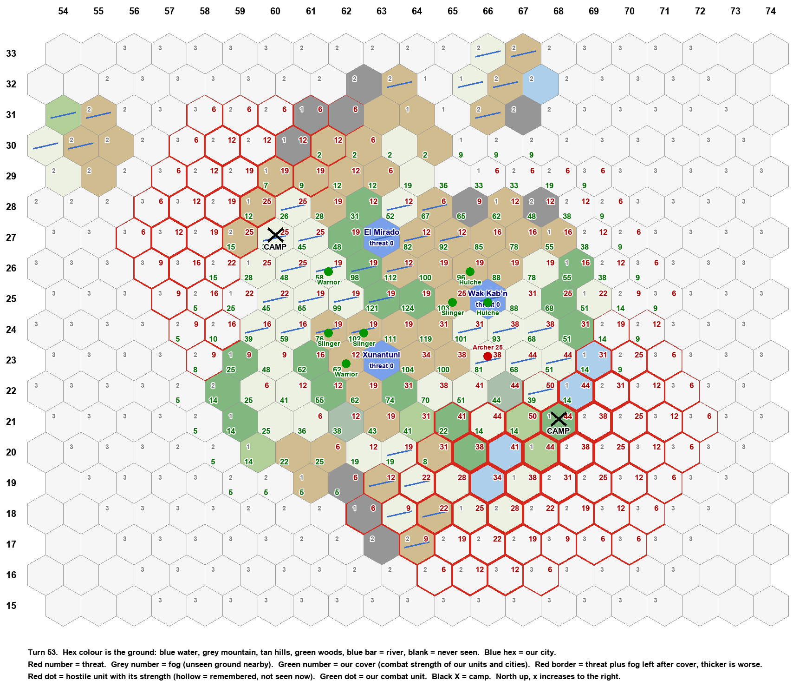

# Threat map (issue 238)

One shared record of what threatens the bot, kept between turns, so every policy reads the same
picture. Stage 1 builds it and dumps it; no policy reads it yet. The plan is in the issue.

## Why

In a practice run a barbarian camp stood four tiles from a city for thirty turns. The game's map
showed it the whole time. The bot did not act, because it forgot, or never recorded, what it could
not see this turn, and each policy kept its own partial memory (`_camps`, `_sightings`,
`_recon_bad`, settling's per-turn `_Danger`).

## The record: sources

A **source** is one thing that threatens us: a camp, or a hostile unit last seen at a tile.
Fields: `kind`, `x`, `y`, `strength`, `first_seen`, `last_seen`, `unit_type`, `hostile_owner`,
`naval`. `last_seen` is the turn it was last confirmed on a *visible* tile; `None` means the map
remembers it but it has never been confirmed in this session. The grid of numbers is only a view
of the sources: `threat_at(x, y)` sums each source's strength, faded linearly with tile distance
to the source's radius.

## Legal reads (what may become a source)

| Source | Read | Rule |
|---|---|---|
| Barbarian camp | `get_map_area` around each city | A camp on a revealed tile is a source (the player's map keeps drawing it). It is dropped only when a **visible** tile shows no camp. This is the one improvement kept on fogged tiles (`build_tile`, `state/fog.py`). |
| Hostile unit | `get_threat_scan` (`read_threats`) | A unit visible now, at its current tile. Kept for `unit_memory_turns` after the last sighting, or replaced by a newer sighting of the same kind within `resight_radius`. |
| Own units, own cities | n/a | Not sources. They feed strength comparisons in later stages. |
| Rival cities | Stage 6 | Use the existing rival memory and `_rival_city_visibility`. No new read. |

## What Stage 1 does and does not include

Included: sources, the threat layer, `danger_near`, a camp scan every `scan_turns` around each
city (the map's own, so a camp is known whether or not enough spare units exist), a per-turn dump
to `runs/<game>_threatmap.jsonl`, and slice metrics.

Not yet: the opportunity layer, `net_value`, `path_clear` and `oldest_knowledge`, used only by later
stages. Spread is by movement (stage 1b): the terrain store gives walkers terrain costs and ships
the water and the coast beside it; a tile never read is slow for a walker and closed to a ship.

## Shapes pinned for later stages (numbers are tuned on slices, not here)

- **`net_value(source)`** is `opportunity - threat - cost`, in the same unit as source strength:
  one point is the strength of a barbarian warrior. Cost is the expected loss from the walk and the
  fight, plus the cost of the units' alternative use. The cost of doing nothing is the threat the
  source keeps producing, counted per turn left standing. Stage 2b chooses the numbers.
- **Mid-turn refresh:** after any read that reveals tiles (a unit moving next to a camp), the
  acting policy calls the map's tile-update with the new read so its own later choices that turn
  see it. Stage 2 adds the call.
- **`DefenceState`** (read by military, gold, faith and production) stays the policies' view of
  "this city is threatened". From Stage 3 the map feeds it, replacing its radius check; every
  reader keeps using `DefenceState`, so release decisions route through it.

## Settings

Everything adjustable lives in `ThreatMapSettings` (radii, memory turns, scan interval). Weights
that a posture should scale will go in the policy document when a policy first uses them. None is
a rule, and each can be overridden or reverted.

## Dump format

One JSON line per turn: `turn`; `sources` (each with `age`, `strength` and `city_distance`); 
`camps_near_city`; `heat` (every tile with threat, as `[x, y, value]`); `cover` (our units and 
cities, same shape); `fog` (unseen-ground penalty near our cities); `cities` and `units` 
(where we stand); and `terrain_new` (ground learned since the last line, as `"x,y": code`).
`scripts/slice_report.py` prints "camp-turns near a city" and the handler's seconds per turn;
`scripts/threat_map_view.py` draws any turn.

## Example

Turn 53 of the camp practice save, drawn by `scripts/threat_map_view.py`. Hex colour is the ground. Red numbers are threat, grey numbers are fog, green numbers are our cover (the combat strength of our units and the defence strength of our cities). A red border marks danger left after cover. The black X marks are two remembered camps, 4 and 5 tiles from our nearest cities.

## The game's pathfinder

`get_pathing_estimate` (the game's own `GetMoveToPath`) is exact for our units, but it answers for
tiles we have never revealed: a probe on the practice save returned a 16-tile path to an unrevealed
tile. It is therefore not used yet. When it is, it may be asked only about a revealed target, and an
estimate whose waypoints include a tile missing from the terrain store is discarded in favour of the
store's own.
