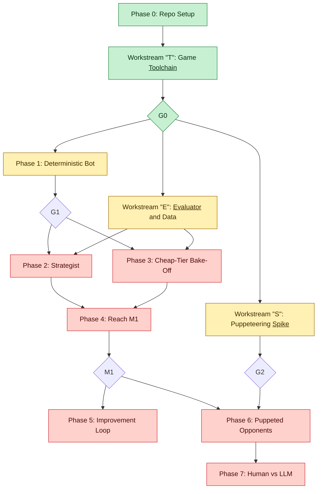
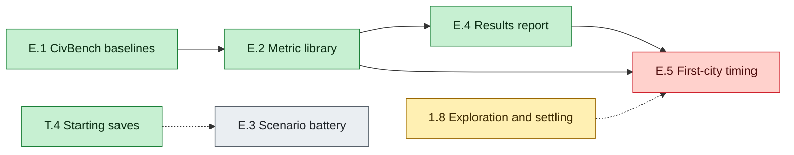
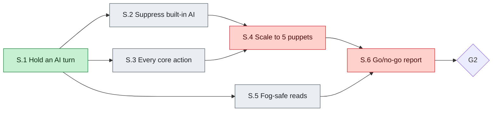

# Roadmap

**Goal:** LLM opponents that a human can play against in Civilization VI, each spending no more than $1 on external model calls per game. Work starts with one LLM player against the built-in AI. Opponents have no personalities.

Issues are generated from [`.github/roadmap-issues.yaml`](.github/roadmap-issues.yaml), so update that file and this one together. A test checks that they match. The reasoning behind these choices is in [`docs/decisions.md`](docs/decisions.md). Statuses are set by hand, so update the tables and diagram colours when an item changes.

**Status key**, used in the tables and as diagram colours:

| Key | Meaning |
|---|---|
| 🟩 Done | Finished. For an item, its issue is closed. |
| 🟨 In progress | Work is merged or underway, but the item isn't finished. |
| 🟥 Blocked | Can't start yet: it waits on a gate or an unfinished item. |
| ⬜ Backlog | Not started, but nothing stops it starting now. |

## Status

| Stage | Status |
|---|---|
| Phase 0: Repo Setup | 🟩 Done |
| Workstream "T": Game <ins>Toolchain</ins> | 🟩 Done. G0 passed. |
| Phase 1: Deterministic Bot | 🟨 In progress: 4 of 44 done, 29 in progress, 11 in backlog. Runs 3 to 6 played full games to the end, but each needed a restart or hands-on help, so G1 has no unattended game yet. [Details](#phase-1-deterministic-bot). |
| Workstream "E": <ins>Evaluator</ins> and Data | 🟨 In progress: 3 of 5 done. |
| Workstream "S": Puppeteering <ins>Spike</ins> | 🟨 In progress: 1 of 6 done. |
| Phase 2: Strategist | 🟥 Blocked: waits on G1. 2 of 6 done ahead of the gate (2.1 and 2.2, built offline). |
| Phase 3: Cheap-Tier Bake-Off | 🟥 Blocked: waits on G1. |
| Phase 4: Reach M1 | 🟥 Blocked: waits on Phases 2 and 3. |
| Phase 5: Improvement Loop | 🟥 Blocked: waits on M1. |
| Phase 6: Puppeted Opponents | 🟥 Blocked: waits on G2 and M1. |
| Phase 7: Human vs LLM | 🟥 Blocked: waits on Phase 6. |

## Sequence

Phases are the main line of work, in order. Workstreams are side work that runs alongside them and feeds in at a gate. Each workstream's letter is the first letter of its underlined word. Phases 1, 2 and 3 and Workstreams "E" and "S" can overlap. Diamonds are hard gates: green when passed, uncoloured until then.

## Gates

| Gate | Passes when | Status |
|---|---|---|
| **G0** | A script reads state, moves a unit and ends a turn, and a test proves the budget governor's hard stop. | 🟩 Passed |
| **G1** | Three unattended full games complete with zero LLM calls. | Not yet: no unattended game so far |
| **G2** | A scripted bot plays a puppet with the built-in AI fully suppressed for 50 turns. On no-go, work stops for an owner decision. | Not yet |
| **M1** | At least 8 standard games complete unattended, none above $1.00, with mean rank 3 of 6 or better, or at least 2 wins. | Not yet |

Standard game: 6 players, Small map, Quick speed, Prince, Gathering Storm, fixed starting saves.

## Phase 0: Repo Setup

**Purpose:** A clean, public-ready repo before any game code exists.

Local only and tracked here, because it comes before the GitHub repo exists. **Exit:** clean tree, tests and lint passing, ready to push.

| Item | Task | Status |
|---|---|---|
| `0.1` | Git repo, ignore rules, environment example, README, report moved to `docs/research/` | 🟩 Done |
| `0.2` | Python project, one smoke test, lint config | 🟩 Done |
| `0.3` | GitHub Actions CI and issue template | 🟩 Done |
| `0.4` | This roadmap and the decision log | 🟩 Done |
| `0.5` | Issue seed and creation script | 🟩 Done |
| `0.6` | Public-ready checks and secret scanning | 🟩 Done |
| `0.7` | Final check and initial commit | 🟩 Done |

## Workstream "T": Game <ins>Toolchain</ins>

**Purpose:** Connect to Civ VI, read and change the game, cap model spend, and fix a set of starting saves so games can be compared.

Sequential, except T.3. Leads to **G0**.

| Item | Task | Status |
|---|---|---|
| [`T.1`](https://github.com/AlexNewell/civ_6_ai/issues/1) | Set up Civ VI tooling | 🟩 Done |
| [`T.2`](https://github.com/AlexNewell/civ_6_ai/issues/2) | Pin civ6-mcp and verify connection, state read and write | 🟩 Done |
| [`T.3`](https://github.com/AlexNewell/civ_6_ai/issues/3) | Spend ledger and budget governor | 🟩 Done |
| [`T.4`](https://github.com/AlexNewell/civ_6_ai/issues/4) | Standard T1 save set | 🟩 Done |

## Phase 1: Deterministic Bot

**Purpose:** A rule-based bot that plays full games alone. It's the free baseline, and the base the model-driven phases build on.

No external model calls. Policies 1.5-1.12 can run in parallel. Leads to **G1**.

Run 3 played a full game to the end (turn 318, a German science victory) with 1.1-1.8, 1.10-1.12 and the first slice of 1.9 wired into the bot. It needed hands-on help at four holds, so G1 has no unattended game yet. Run 4 ended in a Sumerian culture victory at turn 325, and Run 6 in a German score victory at turn 331 after one stop and resume at turn 102 (write-ups in [`docs/live-checks.md`](docs/live-checks.md)). Items 1.19 onwards came from the policy-effectiveness research ([`docs/policy-effectiveness.md`](docs/policy-effectiveness.md)) and Run 6; each item's notes say whether it has been checked live.

```mermaid
flowchart TD
    P11["1.1 Turn loop"] --> P12["1.2 Blocker resolver"] & P13["1.3 Monitors"] & P14["1.4 State layer"]
    P11 --> P118["1.18 Per-call wait"]
    P12 & P13 & P14 --> POL
    subgraph POL["Policies"]
        P15["1.5 City production"] ~~~ P16["1.6 Builders"] ~~~ P17["1.7 Research and civics"] ~~~ P18["1.8 Exploration and settling"]
        P19["1.9 Military"] ~~~ P110["1.10 Government"] ~~~ P111["1.11 Trade, religion, great people"] ~~~ P112["1.12 Diplomacy"]
    end
    P12 --> P113["1.13 Unattended runner"]
    P15 & P19 --> P114["1.14 Spend gold"]
    P19 & P112 --> P115["1.15 Peace-making"]
    P112 --> P116["1.16 Resource trades"]
    P111 --> P117["1.17 Spend faith"]
    P12 --> P119["1.19 Claim-GP blocker"] & P125["1.25 Congress results blocker"]
    P15 --> P120["1.20 Refusal memory"] & P129["1.29 Planned districts"] & P134["1.34 Construction log"]
    P110 --> P121["1.21 Cards and governors"]
    P113 --> P122["1.22 Effectiveness in summary"] & P132["1.32 Preflight"]
    P111 --> P123["1.23 GP and envoy logging"]
    P16 & P19 & P117 --> P124["1.24 Refusals"]
    P117 --> P126["1.26 Unbuyable GP cost"]
    P19 --> P127["1.27 Cities lost"]
    P19 & P114 & P115 --> P135["1.35 War-time defence"]
    P19 --> P136["1.36 Defenders in cities"]
    P18 & P110 --> P137["1.37 Loyalty-aware settling"]
    P13 --> P138["1.38 Richer city events"]
    P14 --> P139["1.39 Rival score logging"] --> P140["1.40 Score vs leader"]
    P122 --> P140
    P18 --> P141["1.41 Six cities by T150"]
    P15 & P17 --> P143["1.43 Science rank"]
    P134 --> P144["1.44 Wonder log"]
    P120 & P129 --> P145["1.45 Placement precheck"]
    P115 & P143 --> P146["1.46 Rival victory threat"]
    P128["1.28 Live checks"] ~~~ P142["1.42 Early-game gap"] ~~~ P130["1.30 Run docs"] ~~~ P131["1.31 civ6-mcp review"] ~~~ P133["1.33 Strength review"]

    classDef done fill:#c7f0d2,stroke:#1a7f37,color:#0b2e13
    classDef progress fill:#fff0b3,stroke:#9a6700,color:#3d2a00
    classDef blocked fill:#ffd1cc,stroke:#cf222e,color:#4a0a0a
    classDef backlog fill:#eaeef2,stroke:#57606a,color:#1f2328
    class P11,P13,P14,P130 done
    class P12,P15,P16,P17,P18,P19,P110,P111,P112,P113,P114,P115,P116,P117,P118,P119,P120,P121,P122,P123,P124,P125,P126,P127,P129,P131,P132,P133,P134 progress
    class P128,P135,P136,P137,P138,P139,P140,P141,P142,P143,P144 backlog
```

| Item | Task | Status | Notes |
|---|---|---|---|
| [`1.1`](https://github.com/AlexNewell/civ_6_ai/issues/5) | Orchestrator turn loop on GameState | 🟩 Done | |
| [`1.2`](https://github.com/AlexNewell/civ_6_ai/issues/6) | Blocker resolver | 🟨 In progress | Played in Run 3, but four holds needed hands-on help. |
| [`1.3`](https://github.com/AlexNewell/civ_6_ai/issues/7) | Scheduled monitors and escalation event bus | 🟩 Done | |
| [`1.4`](https://github.com/AlexNewell/civ_6_ai/issues/8) | Compact typed state layer | 🟩 Done | |
| [`1.5`](https://github.com/AlexNewell/civ_6_ai/issues/9) | City production policy | 🟨 In progress | Merged and played in Run 3. |
| [`1.6`](https://github.com/AlexNewell/civ_6_ai/issues/10) | Builder policy | 🟨 In progress | Merged and played in Run 3. |
| [`1.7`](https://github.com/AlexNewell/civ_6_ai/issues/11) | Research and civics policy | 🟨 In progress | Merged and played in Run 3. |
| [`1.8`](https://github.com/AlexNewell/civ_6_ai/issues/12) | Exploration and settling policy | 🟨 In progress | Merged and played in Run 3. |
| [`1.9`](https://github.com/AlexNewell/civ_6_ai/issues/13) | Military: defence, healing and combat targeting | 🟨 In progress | First slice played in Run 3. Second slice has unit tests only. |
| [`1.10`](https://github.com/AlexNewell/civ_6_ai/issues/14) | Government, policies and governors | 🟨 In progress | Merged and played in Run 3. |
| [`1.11`](https://github.com/AlexNewell/civ_6_ai/issues/15) | Trade, religion and great people | 🟨 In progress | Merged and played in Run 3. Great people are not met: Run 4 turn 227 showed many left unactivated, so the criteria now require that they don't pile up. |
| [`1.12`](https://github.com/AlexNewell/civ_6_ai/issues/16) | Basic diplomacy and World Congress rules | 🟨 In progress | Merged and played in Run 3. |
| [`1.13`](https://github.com/AlexNewell/civ_6_ai/issues/17) | Unattended runner: watchdog, crash recovery and overnight queue | 🟨 In progress | Offline parts merged (run queue, stall watchdog, run records, stop-time screenshots and a triage summary). Not checked live, except that the screenshot capture works on a loaded save. |
| [`1.14`](https://github.com/AlexNewell/civ_6_ai/issues/87) | Spend gold: purchases and unit upgrades | 🟨 In progress | Merged with unit tests. Not checked live. |
| [`1.15`](https://github.com/AlexNewell/civ_6_ai/issues/88) | Peace-making and war awareness | 🟨 In progress | Merged with unit tests. Not checked live. |
| [`1.16`](https://github.com/AlexNewell/civ_6_ai/issues/89) | Propose resource trades | 🟨 In progress | Merged with unit tests. Not checked live. |
| [`1.17`](https://github.com/AlexNewell/civ_6_ai/issues/90) | Spend faith and use prophets | 🟨 In progress | Merged with unit tests. Not checked live. |
| [`1.18`](https://github.com/AlexNewell/civ_6_ai/issues/112) | Cut civ6-mcp's per-call wait | 🟨 In progress | PR 116 shortened the waits: Run 6 decision mean 11.1 s. The remaining wait and its live check are open. |
| [`1.19`](https://github.com/AlexNewell/civ_6_ai/issues/137) | Handle the claim-great-person blocker | 🟨 In progress | PR 144 merged with unit tests. Not checked live. |
| [`1.20`](https://github.com/AlexNewell/civ_6_ai/issues/138) | Production refusal memory | 🟨 In progress | PR 143 merged with unit tests. Not checked live. |
| [`1.21`](https://github.com/AlexNewell/civ_6_ai/issues/139) | Stop re-setting policy cards; finish governor placement | 🟨 In progress | PR 164 merged with unit tests: each card is set at most twice per government. Not checked live. Unknown: why a card the game accepted reads empty the next turn. |
| [`1.22`](https://github.com/AlexNewell/civ_6_ai/issues/140) | Wire policy_effectiveness into the run summary | 🟨 In progress | PR 160 merged: the run summary prints the G1 gate checks and warnings. Not checked live. |
| [`1.23`](https://github.com/AlexNewell/civ_6_ai/issues/141) | Log activation success, wasted great people and envoy tokens | 🟨 In progress | PR 170 merged: great-person, gold-spent and envoy-token lines feed the checks. Not checked live. |
| [`1.24`](https://github.com/AlexNewell/civ_6_ai/issues/142) | Builder, faith and military refusals | 🟨 In progress | PR 163 merged (builder, military, activation, upgrades) and PR 159 (faith). Not checked live. Missionary purchases wait on a religion-spreading policy. |
| [`1.25`](https://github.com/AlexNewell/civ_6_ai/issues/145) | Handle the World Congress results blocker | 🟨 In progress | PR 169 merged with unit tests. Not checked live. |
| [`1.26`](https://github.com/AlexNewell/civ_6_ai/issues/146) | Faith: treat an unreachable great-person cost as not buyable | 🟨 In progress | PR 159 merged with unit tests. Not checked live. |
| [`1.27`](https://github.com/AlexNewell/civ_6_ai/issues/147) | Why were cities lost? (research) | 🟨 In progress | PR 167 merged: [`docs/research/cities-lost.md`](docs/research/cities-lost.md). 11 of 15 losses were captures within 10 turns of an AI's war, and 4 were loyalty losses. |
| [`1.28`](https://github.com/AlexNewell/civ_6_ai/issues/148) | Live-check checklist for the next run | ⬜ Backlog | Needs the next full game. |
| [`1.29`](https://github.com/AlexNewell/civ_6_ai/issues/149) | Replace the hard-coded unwanted-district list with a planned policy | 🟨 In progress | PR 166 merged: `policies/districts.py` decides each special district per city. Not checked live. |
| [`1.30`](https://github.com/AlexNewell/civ_6_ai/issues/150) | Docs: record Runs 5 and 6, fix run labels, add 1.19 to 1.29 to the roadmap | 🟩 Done | PRs 157 and 158 merged (Run 5 and 6 write-ups, run labels), and this roadmap update. |
| [`1.31`](https://github.com/AlexNewell/civ_6_ai/issues/151) | Review the pinned civ6-mcp: our patches, upstream fixes and the noise we see | 🟨 In progress | PR 165 merged: a patch table in [`docs/decisions.md`](docs/decisions.md) and a fix for the victory-check decimal. The pin is upstream's latest commit, so there's no bump to make. |
| [`1.32`](https://github.com/AlexNewell/civ_6_ai/issues/152) | Preflight check in run_game.py for dependencies and screenshots | 🟨 In progress | PR 161 merged with unit tests. Not checked live. |
| [`1.33`](https://github.com/AlexNewell/civ_6_ai/issues/153) | Strength review: where we trailed Germany on score in Run 6 | 🟨 In progress | PR 162 merged: [`docs/research/strength-run6.md`](docs/research/strength-run6.md). Open: no log records rival scores, so the gap to the leader can't be measured yet. |
| [`1.34`](https://github.com/AlexNewell/civ_6_ai/issues/156) | Construction event log and a build tracker that spots gaps | 🟨 In progress | PRs 168 and 172 merged: construction events, a build ledger restored on restart, a per-turn gap line, and buffered event writes (about 0.7 ms a turn in tests). Not checked live. Feeding gaps into production scoring is left. |
| [`1.35`](https://github.com/AlexNewell/civ_6_ai/issues/174) | Raise defence when a war starts or a threat appears | ⬜ Backlog | From the cities-lost research (1.27). |
| [`1.36`](https://github.com/AlexNewell/civ_6_ai/issues/175) | Get defenders into threatened cities | ⬜ Backlog | From 1.27. |
| [`1.37`](https://github.com/AlexNewell/civ_6_ai/issues/176) | Loyalty-aware settling and loyalty response | ⬜ Backlog | From 1.27. |
| [`1.38`](https://github.com/AlexNewell/civ_6_ai/issues/177) | Richer city events: who took a city, why, and across restarts | ⬜ Backlog | From 1.27 and 1.33. |
| [`1.39`](https://github.com/AlexNewell/civ_6_ai/issues/178) | Log rival scores, cities and population each turn | ⬜ Backlog | From the strength review (1.33). |
| [`1.40`](https://github.com/AlexNewell/civ_6_ai/issues/179) | Score-vs-leader report against the CivBench baselines | ⬜ Backlog | Waits on 1.39. |
| [`1.41`](https://github.com/AlexNewell/civ_6_ai/issues/180) | Expansion target: 6 cities by turn 150 | ⬜ Backlog | From 1.33. |
| [`1.42`](https://github.com/AlexNewell/civ_6_ai/issues/181) | Close the early-game score gap (research) | ⬜ Backlog | From 1.33. |
| [`1.43`](https://github.com/AlexNewell/civ_6_ai/issues/182) | Keep science rank at or above the median | ⬜ Backlog | From 1.33. |
| [`1.44`](https://github.com/AlexNewell/civ_6_ai/issues/183) | Log wonder completions | ⬜ Backlog | From 1.33. |
| [`1.45`](https://github.com/AlexNewell/civ_6_ai/issues/187) | Check district placement before choosing it | ⬜ Backlog | From Run 7: 59% of production choices refused, most for no valid tile. |
| [`1.46`](https://github.com/AlexNewell/civ_6_ai/issues/188) | Notice and respond to a rival nearing victory | ⬜ Backlog | From Run 7: Germany won by science with nothing reacting. |

## Workstream "E": <ins>Evaluator</ins> and Data

**Purpose:** Measure how well the bot plays, so each change is judged on data rather than impressions: baselines from CivBench, metrics, short test scenarios and reports.

Parallel with Phase 1. Dotted arrows come from items in other sections.

| Item | Task | Status | Notes |
|---|---|---|---|
| [`E.1`](https://github.com/AlexNewell/civ_6_ai/issues/18) | Ingest CivBench dataset and extract baselines | 🟩 Done | |
| [`E.2`](https://github.com/AlexNewell/civ_6_ai/issues/19) | Metric library | 🟩 Done | |
| [`E.3`](https://github.com/AlexNewell/civ_6_ai/issues/20) | Short mid-game scenario battery | ⬜ Backlog | |
| [`E.4`](https://github.com/AlexNewell/civ_6_ai/issues/21) | Results report with confidence intervals | 🟩 Done | |
| [`E.5`](https://github.com/AlexNewell/civ_6_ai/issues/62) | First-city timing study | 🟥 Blocked | Waits on 1.8. |

## Workstream "S": Puppeteering <ins>Spike</ins>

**Purpose:** Find out whether our code can fully control an AI player, which LLM opponents beside a human require.

Parallel with Phase 1, and tests whether the long-term goal is possible. FireTuner is disabled in multiplayer, so opponents must control AI slots in single-player. Leads to **G2**.

| Item | Task | Status | Notes |
|---|---|---|---|
| [`S.1`](https://github.com/AlexNewell/civ_6_ai/issues/22) | Lua mod: intercept and hold an AI turn | 🟩 Done | |
| [`S.2`](https://github.com/AlexNewell/civ_6_ai/issues/23) | Suppress the built-in AI and measure leaks | ⬜ Backlog | |
| [`S.3`](https://github.com/AlexNewell/civ_6_ai/issues/24) | Issue every core action for a puppet | ⬜ Backlog | |
| [`S.4`](https://github.com/AlexNewell/civ_6_ai/issues/25) | Scale to 5 puppets beside a human | 🟥 Blocked | Waits on S.2 and S.3. |
| [`S.5`](https://github.com/AlexNewell/civ_6_ai/issues/26) | Fog-of-war-safe read layer prototype | ⬜ Backlog | |
| [`S.6`](https://github.com/AlexNewell/civ_6_ai/issues/27) | Puppeteering go/no-go report | 🟥 Blocked | Waits on S.4 and S.5. |

## Phase 2: Strategist

**Purpose:** Add one model call, the strategist, that sets the bot's goals a few times a game, and measure what it costs.

Starts after G1.

| Item | Task | Status |
|---|---|---|
| [`2.1`](https://github.com/AlexNewell/civ_6_ai/issues/28) | Policy document schema | 🟩 Done |
| [`2.2`](https://github.com/AlexNewell/civ_6_ai/issues/29) | Persistent task DB with deadlines | 🟩 Done |
| [`2.3`](https://github.com/AlexNewell/civ_6_ai/issues/30) | Strategist call with structured output | 🟥 Blocked |
| [`2.4`](https://github.com/AlexNewell/civ_6_ai/issues/31) | Reply store and replay mode | 🟥 Blocked |
| [`2.5`](https://github.com/AlexNewell/civ_6_ai/issues/32) | Measure real per-call and per-game cost | 🟥 Blocked |
| [`2.6`](https://github.com/AlexNewell/civ_6_ai/issues/33) | Sonnet 5.5 vs Opus 5.5 at the same dollar cap | 🟥 Blocked |

## Phase 3: Cheap-Tier Bake-Off

**Purpose:** Find a cheaper model for the many small decisions, tested on recorded game situations before live games.

Parallel with Phase 2, offline first.

| Item | Task | Status |
|---|---|---|
| [`3.1`](https://github.com/AlexNewell/civ_6_ai/issues/34) | Build a replay corpus | 🟥 Blocked |
| [`3.2`](https://github.com/AlexNewell/civ_6_ai/issues/35) | Router interface: code, cheap tier, strategist | 🟥 Blocked |
| [`3.3`](https://github.com/AlexNewell/civ_6_ai/issues/36) | Benchmark Haiku 5.5 | 🟥 Blocked |
| [`3.4`](https://github.com/AlexNewell/civ_6_ai/issues/37) | Benchmark local models | 🟥 Blocked |
| [`3.5`](https://github.com/AlexNewell/civ_6_ai/issues/38) | Benchmark Jev | 🟥 Blocked |
| [`3.6`](https://github.com/AlexNewell/civ_6_ai/issues/39) | Pick a cheap tier and integrate live | 🟥 Blocked |

## Phase 4: Reach M1

**Purpose:** Tune the bot until it wins or ranks well at $1 or less a game.

Starts after Phases 2 and 3. Leads to **M1**.

| Item | Task | Status |
|---|---|---|
| [`4.1`](https://github.com/AlexNewell/civ_6_ai/issues/40) | Tuning rounds | 🟥 Blocked |
| [`4.2`](https://github.com/AlexNewell/civ_6_ai/issues/41) | Formal M1 benchmark and report | 🟥 Blocked |

## Phase 5: Improvement Loop

**Purpose:** Let Claude propose policy improvements from game logs, and test and promote them automatically.

Starts after M1, and can overlap Phase 6. Code changes are promoted only between games, and full games confirm what fast scenarios select.

| Item | Task | Status |
|---|---|---|
| [`5.1`](https://github.com/AlexNewell/civ_6_ai/issues/42) | Telemetry-driven failure analysis | 🟥 Blocked |
| [`5.2`](https://github.com/AlexNewell/civ_6_ai/issues/43) | Candidate policy sandbox | 🟥 Blocked |
| [`5.3`](https://github.com/AlexNewell/civ_6_ai/issues/44) | First Claude-written policy improvement | 🟥 Blocked |
| [`5.4`](https://github.com/AlexNewell/civ_6_ai/issues/45) | Automated promotion pipeline | 🟥 Blocked |
| [`5.5`](https://github.com/AlexNewell/civ_6_ai/issues/46) | Versioned policy registry and rollback | 🟥 Blocked |

## Phase 6: Puppeted Opponents

**Purpose:** Run the LLM bot as the AI opponents in a game, each seeing only what its own player can see.

Needs G2, M1 and a budget review, because a five-opponent test game can cost up to $5.

| Item | Task | Status |
|---|---|---|
| [`6.1`](https://github.com/AlexNewell/civ_6_ai/issues/47) | Vendor civ6-mcp and add player_id support | 🟥 Blocked |
| [`6.2`](https://github.com/AlexNewell/civ_6_ai/issues/48) | Production puppet mod and coordinator | 🟥 Blocked |
| [`6.3`](https://github.com/AlexNewell/civ_6_ai/issues/49) | Enforced fog-of-war reads | 🟥 Blocked |
| [`6.4`](https://github.com/AlexNewell/civ_6_ai/issues/50) | One LLM puppet vs built-in AI | 🟥 Blocked |
| [`6.5`](https://github.com/AlexNewell/civ_6_ai/issues/51) | Five LLM puppets in one game | 🟥 Blocked |
| [`6.6`](https://github.com/AlexNewell/civ_6_ai/issues/52) | Meet the opponent latency target | 🟥 Blocked |

## Phase 7: Human vs LLM

**Purpose:** Make it something a person can set up and play against.

Needs Phase 6.

| Item | Task | Status |
|---|---|---|
| [`7.1`](https://github.com/AlexNewell/civ_6_ai/issues/53) | One-command setup and launch | 🟥 Blocked |
| [`7.2`](https://github.com/AlexNewell/civ_6_ai/issues/54) | Human-turn experience polish | 🟥 Blocked |
| [`7.3`](https://github.com/AlexNewell/civ_6_ai/issues/55) | Human strength and fairness playtest | 🟥 Blocked |
| [`7.4`](https://github.com/AlexNewell/civ_6_ai/issues/56) | Decide difficulty calibration and release options | 🟥 Blocked |
