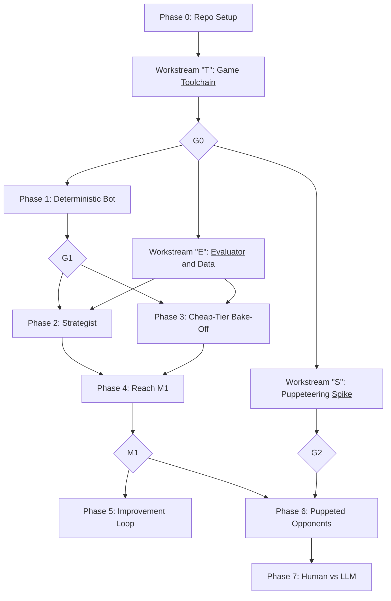

# Roadmap

**Goal:** LLM opponents that a human can play against in Civilization VI, each spending no more than $1 on external model calls per game. Work starts with one LLM player against the built-in AI. Opponents have no personalities.

Issues are generated from [`.github/roadmap-issues.yaml`](.github/roadmap-issues.yaml), so update that file and this one together. A test checks that they match. The reasoning behind these choices is in [`docs/decisions.md`](docs/decisions.md).

## Status

| Stage | Status |
|---|---|
| Phase 0: Repo Setup | Done |
| Workstream "T": Game <ins>Toolchain</ins> | Done |
| Phase 1: Deterministic Bot | In progress. 1.1-1.8, 1.10-1.12 and the first slice of 1.9 are merged and wired into the bot, played to the end of a full game in Run 3 (turn 318, a German science victory), with hands-on help at four holds, so G1 has no unattended game yet. After Run 3, the offline parts of 1.13 (run queue, stall watchdog, run records), 1.14-1.17 (gold, peace, resource offers, faith) and a second 1.9 slice were merged with unit tests only. None has been checked in a live game yet. |
| Workstream "E": <ins>Evaluator</ins> and Data | In progress |
| Workstream "S": Puppeteering <ins>Spike</ins> | In progress |
| Everything else | Not started |

## Sequence

Phases are the main line of work, in order. Workstreams are side work that runs alongside them and feeds in at a gate. Each workstream's letter is the first letter of its underlined word. Phases 1, 2 and 3 and Workstreams "E" and "S" can overlap. Diamonds are hard gates.

## Gates

| Gate | Passes when |
|---|---|
| **G0** | A script reads state, moves a unit and ends a turn, and a test proves the budget governor's hard stop. |
| **G1** | Three unattended full games complete with zero LLM calls. |
| **G2** | A scripted bot plays a puppet with the built-in AI fully suppressed for 50 turns. On no-go, work stops for an owner decision. |
| **M1** | At least 8 standard games complete unattended, none above $1.00, with mean rank 3 of 6 or better, or at least 2 wins. |

Standard game: 6 players, Small map, Quick speed, Prince, Gathering Storm, fixed starting saves.

## Phase 0: Repo Setup

**Purpose:** A clean, public-ready repo before any game code exists.

Local only and tracked here, because it comes before the GitHub repo exists. **Exit:** clean tree, tests and lint passing, ready to push.

- `0.1` Git repo, ignore rules, environment example, README, report moved to `docs/research/`
- `0.2` Python project, one smoke test, lint config
- `0.3` GitHub Actions CI and issue template
- `0.4` This roadmap and the decision log
- `0.5` Issue seed and creation script
- `0.6` Public-ready checks and secret scanning
- `0.7` Final check and initial commit

## Workstream "T": Game <ins>Toolchain</ins>

**Purpose:** Connect to Civ VI, read and change the game, cap model spend, and fix a set of starting saves so games can be compared.

Sequential, except T.3. Leads to **G0**.

- [`T.1`](https://github.com/AlexNewell/civ_6_ai/issues/1) Set up Civ VI tooling
- [`T.2`](https://github.com/AlexNewell/civ_6_ai/issues/2) Pin civ6-mcp and verify connection, state read and write
- [`T.3`](https://github.com/AlexNewell/civ_6_ai/issues/3) Spend ledger and budget governor
- [`T.4`](https://github.com/AlexNewell/civ_6_ai/issues/4) Standard T1 save set

## Phase 1: Deterministic Bot

**Purpose:** A rule-based bot that plays full games alone. It's the free baseline, and the base the model-driven phases build on.

No external model calls. Policies 1.5-1.12 can run in parallel. Leads to **G1**.

- [`1.1`](https://github.com/AlexNewell/civ_6_ai/issues/5) Orchestrator turn loop on GameState
- [`1.2`](https://github.com/AlexNewell/civ_6_ai/issues/6) Blocker resolver
- [`1.3`](https://github.com/AlexNewell/civ_6_ai/issues/7) Scheduled monitors and escalation event bus
- [`1.4`](https://github.com/AlexNewell/civ_6_ai/issues/8) Compact typed state layer
- [`1.5`](https://github.com/AlexNewell/civ_6_ai/issues/9) City production policy
- [`1.6`](https://github.com/AlexNewell/civ_6_ai/issues/10) Builder policy
- [`1.7`](https://github.com/AlexNewell/civ_6_ai/issues/11) Research and civics policy
- [`1.8`](https://github.com/AlexNewell/civ_6_ai/issues/12) Exploration and settling policy
- [`1.9`](https://github.com/AlexNewell/civ_6_ai/issues/13) Military: defence, healing and combat targeting
- [`1.10`](https://github.com/AlexNewell/civ_6_ai/issues/14) Government, policies and governors
- [`1.11`](https://github.com/AlexNewell/civ_6_ai/issues/15) Trade, religion and great people
- [`1.12`](https://github.com/AlexNewell/civ_6_ai/issues/16) Basic diplomacy and World Congress rules
- [`1.13`](https://github.com/AlexNewell/civ_6_ai/issues/17) Unattended runner: watchdog, crash recovery and overnight queue
- [`1.14`](https://github.com/AlexNewell/civ_6_ai/issues/87) Spend gold: purchases and unit upgrades
- [`1.15`](https://github.com/AlexNewell/civ_6_ai/issues/88) Peace-making and war awareness
- [`1.16`](https://github.com/AlexNewell/civ_6_ai/issues/89) Propose resource trades
- [`1.17`](https://github.com/AlexNewell/civ_6_ai/issues/90) Spend faith and use prophets
- [`1.18`](https://github.com/AlexNewell/civ_6_ai/issues/112) Cut civ6-mcp's per-call wait

## Workstream "E": <ins>Evaluator</ins> and Data

**Purpose:** Measure how well the bot plays, so each change is judged on data rather than impressions: baselines from CivBench, metrics, short test scenarios and reports.

Parallel with Phase 1.

- [`E.1`](https://github.com/AlexNewell/civ_6_ai/issues/18) Ingest CivBench dataset and extract baselines
- [`E.2`](https://github.com/AlexNewell/civ_6_ai/issues/19) Metric library
- [`E.3`](https://github.com/AlexNewell/civ_6_ai/issues/20) Short mid-game scenario battery
- [`E.4`](https://github.com/AlexNewell/civ_6_ai/issues/21) Results report with confidence intervals
- [`E.5`](https://github.com/AlexNewell/civ_6_ai/issues/62) First-city timing study

## Workstream "S": Puppeteering <ins>Spike</ins>

**Purpose:** Find out whether our code can fully control an AI player, which LLM opponents beside a human require.

Parallel with Phase 1, and tests whether the long-term goal is possible. FireTuner is disabled in multiplayer, so opponents must control AI slots in single-player. Leads to **G2**.

- [`S.1`](https://github.com/AlexNewell/civ_6_ai/issues/22) Lua mod: intercept and hold an AI turn
- [`S.2`](https://github.com/AlexNewell/civ_6_ai/issues/23) Suppress the built-in AI and measure leaks
- [`S.3`](https://github.com/AlexNewell/civ_6_ai/issues/24) Issue every core action for a puppet
- [`S.4`](https://github.com/AlexNewell/civ_6_ai/issues/25) Scale to 5 puppets beside a human
- [`S.5`](https://github.com/AlexNewell/civ_6_ai/issues/26) Fog-of-war-safe read layer prototype
- [`S.6`](https://github.com/AlexNewell/civ_6_ai/issues/27) Puppeteering go/no-go report

## Phase 2: Strategist

**Purpose:** Add one model call, the strategist, that sets the bot's goals a few times a game, and measure what it costs.

Starts after G1.

- [`2.1`](https://github.com/AlexNewell/civ_6_ai/issues/28) Policy document schema
- [`2.2`](https://github.com/AlexNewell/civ_6_ai/issues/29) Persistent task DB with deadlines
- [`2.3`](https://github.com/AlexNewell/civ_6_ai/issues/30) Strategist call with structured output
- [`2.4`](https://github.com/AlexNewell/civ_6_ai/issues/31) Reply store and replay mode
- [`2.5`](https://github.com/AlexNewell/civ_6_ai/issues/32) Measure real per-call and per-game cost
- [`2.6`](https://github.com/AlexNewell/civ_6_ai/issues/33) Sonnet 5.5 vs Opus 5.5 at the same dollar cap

## Phase 3: Cheap-Tier Bake-Off

**Purpose:** Find a cheaper model for the many small decisions, tested on recorded game situations before live games.

Parallel with Phase 2, offline first.

- [`3.1`](https://github.com/AlexNewell/civ_6_ai/issues/34) Build a replay corpus
- [`3.2`](https://github.com/AlexNewell/civ_6_ai/issues/35) Router interface: code, cheap tier, strategist
- [`3.3`](https://github.com/AlexNewell/civ_6_ai/issues/36) Benchmark Haiku 5.5
- [`3.4`](https://github.com/AlexNewell/civ_6_ai/issues/37) Benchmark local models
- [`3.5`](https://github.com/AlexNewell/civ_6_ai/issues/38) Benchmark Jev
- [`3.6`](https://github.com/AlexNewell/civ_6_ai/issues/39) Pick a cheap tier and integrate live

## Phase 4: Reach M1

**Purpose:** Tune the bot until it wins or ranks well at $1 or less a game.

Starts after Phases 2 and 3. Leads to **M1**.

- [`4.1`](https://github.com/AlexNewell/civ_6_ai/issues/40) Tuning rounds
- [`4.2`](https://github.com/AlexNewell/civ_6_ai/issues/41) Formal M1 benchmark and report

## Phase 5: Improvement Loop

**Purpose:** Let Claude propose policy improvements from game logs, and test and promote them automatically.

Starts after M1, and can overlap Phase 6. Code changes are promoted only between games, and full games confirm what fast scenarios select.

- [`5.1`](https://github.com/AlexNewell/civ_6_ai/issues/42) Telemetry-driven failure analysis
- [`5.2`](https://github.com/AlexNewell/civ_6_ai/issues/43) Candidate policy sandbox
- [`5.3`](https://github.com/AlexNewell/civ_6_ai/issues/44) First Claude-written policy improvement
- [`5.4`](https://github.com/AlexNewell/civ_6_ai/issues/45) Automated promotion pipeline
- [`5.5`](https://github.com/AlexNewell/civ_6_ai/issues/46) Versioned policy registry and rollback

## Phase 6: Puppeted Opponents

**Purpose:** Run the LLM bot as the AI opponents in a game, each seeing only what its own player can see.

Needs G2, M1 and a budget review, because a five-opponent test game can cost up to $5.

- [`6.1`](https://github.com/AlexNewell/civ_6_ai/issues/47) Vendor civ6-mcp and add player_id support
- [`6.2`](https://github.com/AlexNewell/civ_6_ai/issues/48) Production puppet mod and coordinator
- [`6.3`](https://github.com/AlexNewell/civ_6_ai/issues/49) Enforced fog-of-war reads
- [`6.4`](https://github.com/AlexNewell/civ_6_ai/issues/50) One LLM puppet vs built-in AI
- [`6.5`](https://github.com/AlexNewell/civ_6_ai/issues/51) Five LLM puppets in one game
- [`6.6`](https://github.com/AlexNewell/civ_6_ai/issues/52) Meet the opponent latency target

## Phase 7: Human vs LLM

**Purpose:** Make it something a person can set up and play against.

Needs Phase 6.

- [`7.1`](https://github.com/AlexNewell/civ_6_ai/issues/53) One-command setup and launch
- [`7.2`](https://github.com/AlexNewell/civ_6_ai/issues/54) Human-turn experience polish
- [`7.3`](https://github.com/AlexNewell/civ_6_ai/issues/55) Human strength and fairness playtest
- [`7.4`](https://github.com/AlexNewell/civ_6_ai/issues/56) Decide difficulty calibration and release options
